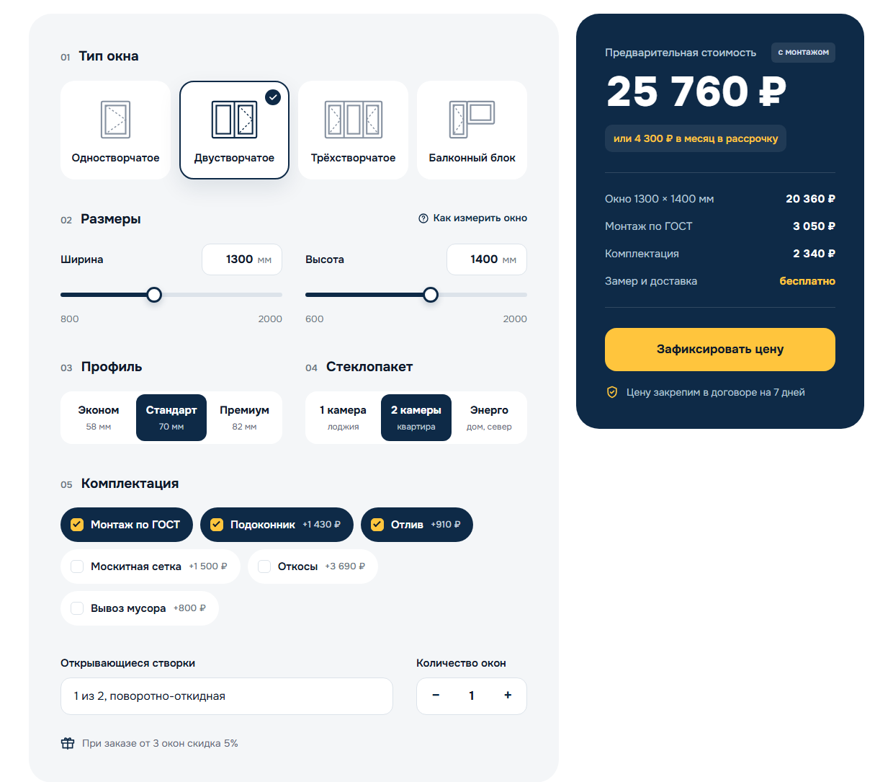

# «Ясно»: лендинг компании по установке окон и дверей

Демо-проект для портфолио. Компания, цены и отзывы вымышлены, заявки никуда не отправляются.

**Демо:** https://karelin-dev.github.io/okna-landing/


| Калькулятор | Мобильная версия |
|---|---|
|  |  |

## Что сделано

- **Дизайн с нуля.** Название, логотип, палитра, иллюстрации в фирменных цветах, макет
  десктопа и логотипа. Вёрстка повторяет макет.
- **Калькулятор стоимости окна.** 4 типа окон, размеры с ограничениями под каждый тип,
  ползунки синхронизированы с полями ввода, профиль, стеклопакет, открывающиеся створки,
  комплектация с ценой каждой опции, количество окон, скидка от 3 окон, платёж в рассрочку.
  Расчёт вынесен в чистую функцию `calculateWindow()`, отдельно от работы с DOM.
  На десктопе итог закреплён сбоку, на телефоне цена видна в плашке внизу экрана.
- **Квиз «Вызвать замерщика».** 4 вопроса и контакты, прогресс, счётчик оставшихся
  вопросов с правильными окончаниями, переход по клику, Enter на промежуточном шаге
  не отправляет заявку.
- **Формы заявок.** Маска телефона, валидация с понятными ошибками, сбор UTM-меток,
  одна точка подключения к API или CRM (`LEAD_ENDPOINT`).
- **Модальное окно.** Фокус не уходит за пределы окна, закрытие по Esc и клику на фон,
  в заявку подставляется расчёт из калькулятора или выбранная категория дверей.
- **Фильтр объектов** по типу, FAQ на `<details>`, мобильное меню.
- **Доступность.** Семантическая разметка, реальные `input` под кастомными контролами,
  aria-атрибуты, видимый фокус, контраст текста по WCAG AA, `prefers-reduced-motion`,
  ссылка «Перейти к содержимому».

**Lighthouse, мобильная версия:** производительность 95, доступность 100,
Best Practices 100, SEO 100.

## Стек

HTML, SCSS (БЭМ, модули `@use`), JavaScript без библиотек, Gulp (sass, PostCSS,
Autoprefixer, cssnano, Terser), BrowserSync. Шрифт Onest, иконки и иллюстрации в SVG.

## Запуск

```bash
npm install
npm run dev     # сервер разработки на http://localhost:3000
npm run build   # сборка в docs/, оттуда сайт публикует GitHub Pages
```

## Структура

```
src/
  index.html
  scss/
    _base.scss        # переменные, сетка, типографика
    _ui.scss          # кнопки, поля, чипы, переключатели
    blocks/           # header, hero, calc, sections
  js/
    modules/          # calculator, quiz, forms, modal, filter, header
    main.js           # инициализация
  assets/img/         # иллюстрации SVG
docs/                 # собранный сайт для GitHub Pages
```

## Подключение отправки заявок

В `src/js/modules/forms.js` укажите адрес в `LEAD_ENDPOINT`. Формы отправят POST с JSON:

```json
{
  "name": "Анна",
  "phone": "+79161234567",
  "form": "quiz",
  "interest": "Окна",
  "amount": "2-3",
  "place": "Квартира",
  "when": "В течение месяца",
  "page": "https://example.com/?utm_source=yandex",
  "utm": { "utm_source": "yandex" },
  "createdAt": "2026-10-27T13:19:03.157Z"
}
```

Пока `LEAD_ENDPOINT` не задан, заявка выводится в консоль браузера.

## Автор

Иван Карелин, [github.com/karelin-dev](https://github.com/karelin-dev)
